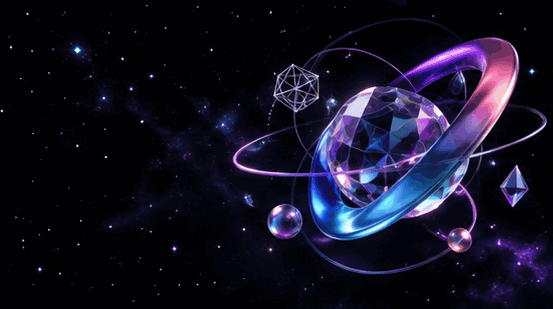

  

<h1 align="center">SIKANDAR MUSHTAQ</h1>

  <strong>Certified Full Stack Engineer</strong> 
  Full Stack Engineer&nbsp; · &nbsp;Python Developer&nbsp; · &nbsp;Three.js Developer

  1 YEAR OF PRACTICAL DEVELOPMENT EXPERIENCE

  Building digital products, modern business solutions and immersive web experiences.

  <a href="https://github.com/Sikandarmushtaq">GITHUB</a>
  &nbsp; / &nbsp;
  <a href="https://www.syncsolvo.com">SYNCSOLVO</a>

  

## 01 / ABOUT

I'm a **Certified Full Stack Engineer** with **1 year of practical development experience**. I build modern web applications by bringing together thoughtful interface design, reliable backend development and creative web technologies.

My work includes SaaS products, online examination platforms, e-commerce websites, business websites and interactive 3D experiences. I enjoy turning ideas into useful digital products while keeping code clear, maintainable and focused on the user.

- Full-stack web application development
- SaaS and business-platform development
- E-commerce and online shopping experiences
- Backend APIs, authentication and database integration
- Interactive 3D websites and motion-driven interfaces

  

## 02 / TECHNOLOGY

| Area | Technologies |
|---|---|
| **Frontend** | HTML5, CSS3, JavaScript, TypeScript, React.js, Next.js, Tailwind CSS |
| **Backend** | Node.js, Express.js, Python, REST APIs, JWT Authentication |
| **Databases** | MongoDB, Mongoose, PostgreSQL |
| **3D & Motion** | Three.js, React Three Fiber, GSAP, ScrollTrigger, Lenis |
| **Tools** | Git, GitHub, Postman |

  

## 03 / SELECTED PROJECTS

### 01 — Edunexa
**SaaS Product**

A SaaS-based digital product focused on delivering scalable solutions through a modern, user-friendly experience.

### 02 — Exam Portal
**Online Examination Platform**

A separate online examination project focused on digital assessments and a structured online testing experience.

### 03 — ShopSphere
**E-Commerce Website**

An e-commerce website focused on product discovery, online shopping and a smooth customer experience.

### 04 — SyncSolvo
**Business Website**

A professional business website presenting digital services and business solutions.

[Visit SyncSolvo](https://www.syncsolvo.com)

### 05 — 3D Developer Portfolio
**Interactive 3D Web Experience**

A creative developer portfolio exploring immersive 3D elements, animation and modern frontend technologies.

**Core technologies:** React, Three.js, React Three Fiber, GSAP and Lenis.

  

## 04 / WHAT I ENJOY BUILDING

- SaaS applications and digital products
- E-commerce websites
- Online examination platforms
- Business websites and service platforms
- REST APIs and database-backed applications
- Interactive 3D and animation-rich web experiences

  

## 05 / CURRENT FOCUS

- Strengthening Python and backend development
- Building maintainable full-stack applications
- Exploring creative 3D experiences for the web
- Improving performance, accessibility and user experience

  

## 06 / CONNECT

**GitHub:** [github.com/Sikandarmushtaq](https://github.com/Sikandarmushtaq)  
**Business Website:** [www.syncsolvo.com](https://www.syncsolvo.com)

---

  <strong>BUILD WITH PURPOSE. CREATE WITH IMAGINATION.</strong> 
  Always learning · Always building · Always improving

